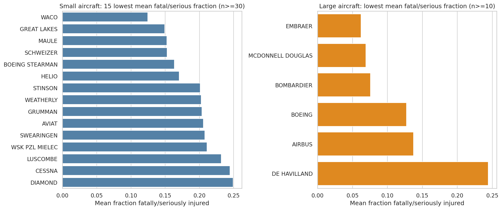
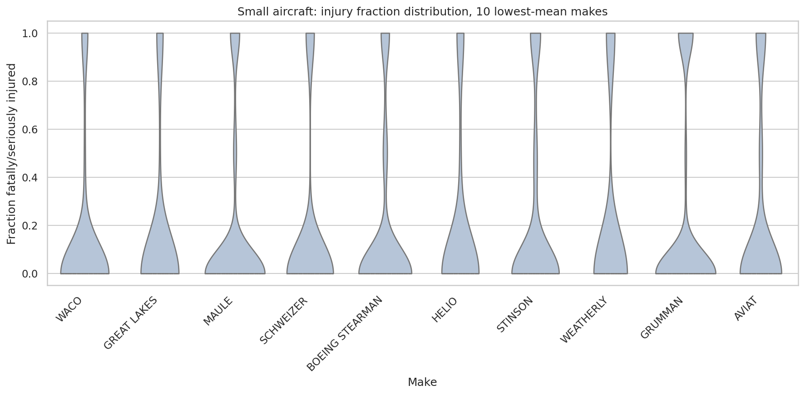
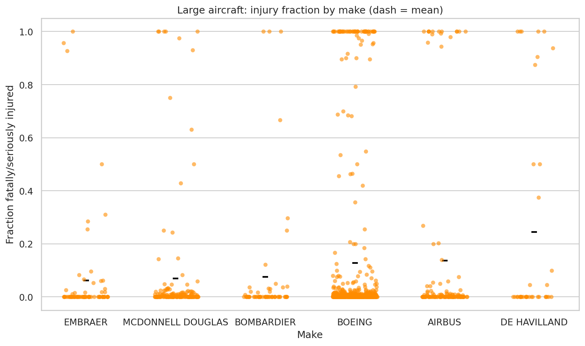
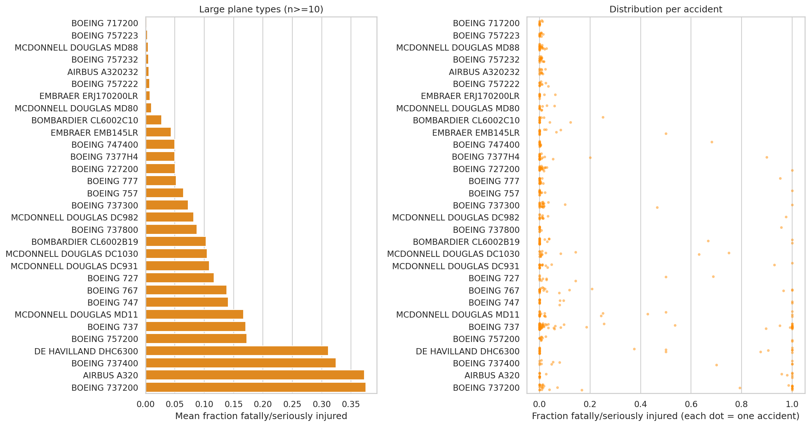
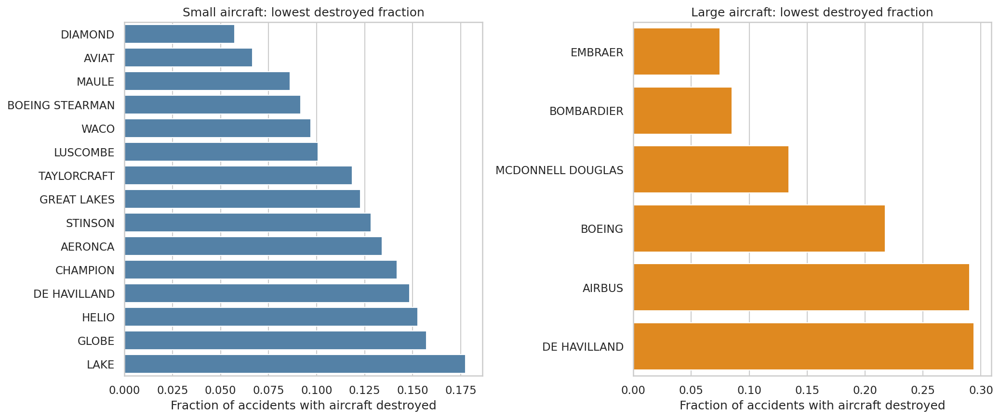
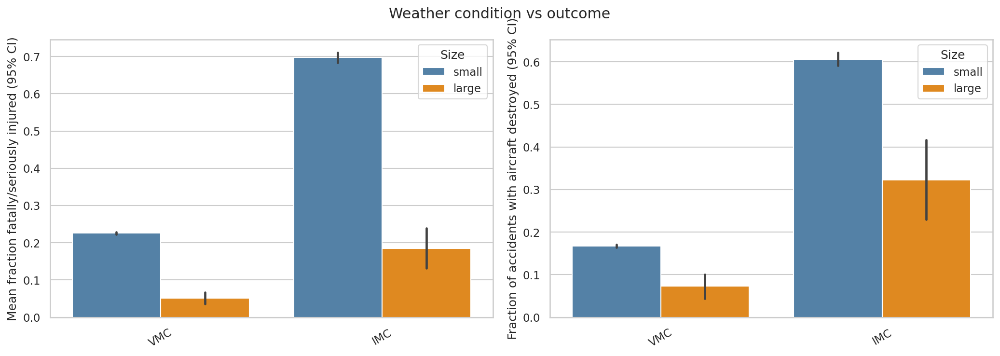
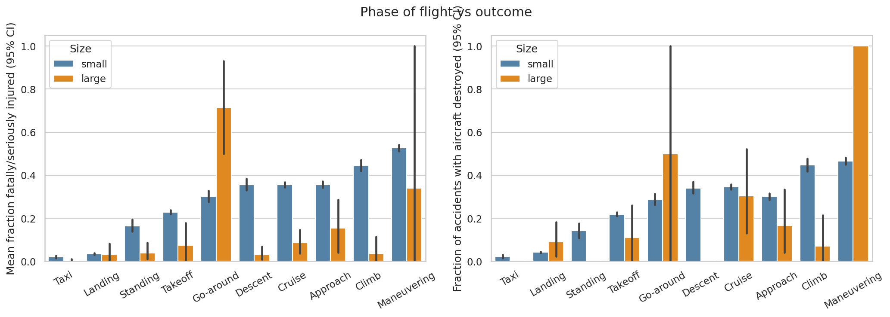
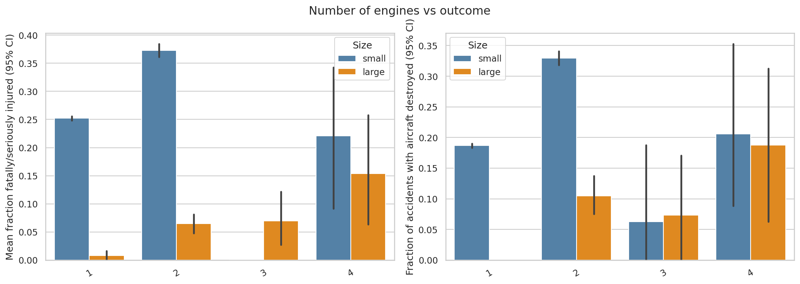

# Aviation Accident Analysis

Safety analysis of commercial/passenger airplanes for an airline/airplane insurer, based on NTSB accident data (1948-2023).

## Business question
Which airplane makes/models show low rates of total destruction and low likelihood of fatal/serious injury in an accident, and which general factors drive outcomes? Separate recommendations for **small** (<20 people on board) and **large** aircraft.

## Repository contents
| File | Purpose |
|---|---|
| `Aviation_Accidents_Cleaning.ipynb` | Load, filter, clean, build derived metrics, save `Aviation_Cleaned.csv` |
| `Aviation_Accidents_Data_Analysis.ipynb` | EDA, make/model rankings, factor analysis |
| `AviationData.csv`, `USState_Codes.csv` | Raw data |
| `images/` | Figures used below |

## Data preparation (summary)
- Events from **1983 onward** (40-year lifetime), **professional builds** only (`Amateur.Built == 'No'`), **accidents** only (incidents excluded), category **Airplane** (missing categories imputed from other records of the same Make+Model).
- `Total_Onboard` = fatal + serious + minor + uninjured. `FatalSerious_Frac` = (fatal + serious) / `Total_Onboard`. `Destroyed` = 1 if aircraft damage is "Destroyed".
- Make names standardised/merged; Boeing-Stearman biplanes separated from Boeing jets; `Aircraft_Type` = Make + Model.
- Robustness: makes need >= 30 (small) / >= 10 (large) accidents; plane types need >= 10; factor comparisons use 95% CIs and Mann-Whitney / chi-square / Kruskal-Wallis tests.
- Size split: a plane type is *large* if its 75th-percentile people on board is >= 20 (threshold of 20).
- Final dataset: 56,126 accidents, 45 makes.

## Recommendations

**Small aircraft**
- Makes: **Maule** (mean fatal/serious fraction 0.153, 8.6% destroyed, n=534) is the best-supported. Also consider **Waco**, **Boeing-Stearman** (vintage), **Aviat** and **Diamond** (lowest destruction rates, 6-7%). Cessna (n=24,881) averages 0.245.
- Models: **Maule MX-7-235** (0.021, n=24), **Maule M-4** (0.038, n=26), **Piper PA-18-160** (0.045, n=33).

**Large aircraft**
- Makes: **Embraer** (0.062), **McDonnell Douglas** (0.069), **Bombardier** (0.076); Boeing 0.127 and Airbus 0.137 are acceptable. Lowest destroyed fractions: Embraer 7.5%, Bombardier 8.5%.
- Models (n >= 10): **Boeing 717-200, 757-222/223/232, McDonnell Douglas MD-80/MD-88, Airbus A320-232, Embraer ERJ-170/EMB-145, Bombardier CL-600-2C10** (fatal/serious fraction < 0.05, none destroyed). Avoid Boeing 737-200 / 737-400 and the DHC-6-300 (0.31-0.38).

## Factors affecting outcomes
1. **Weather (IMC vs VMC):** IMC accidents average a 0.678 fatal/serious fraction and 60% destroyed vs 0.224 and 16.7% in VMC; the gap holds for large aircraft (0.185 vs 0.051).
   
2. **Phase of flight:** Taxi (0.020) and landing (0.035) are the safest; maneuvering (0.527) and climb (0.438) the most dangerous.
   
3. **Number of engines (additional):** twin-engine aircraft are worse than singles (0.342 vs 0.252), likely confounded by speed, altitude and IMC use.
   

## Limitations
No exposure data (flights flown), so results are *per accident*, not per flight. Large-aircraft samples are small (6 makes, 31 types with >= 10 accidents). Total people on board includes crew. Findings on factors are associations, not causal.
